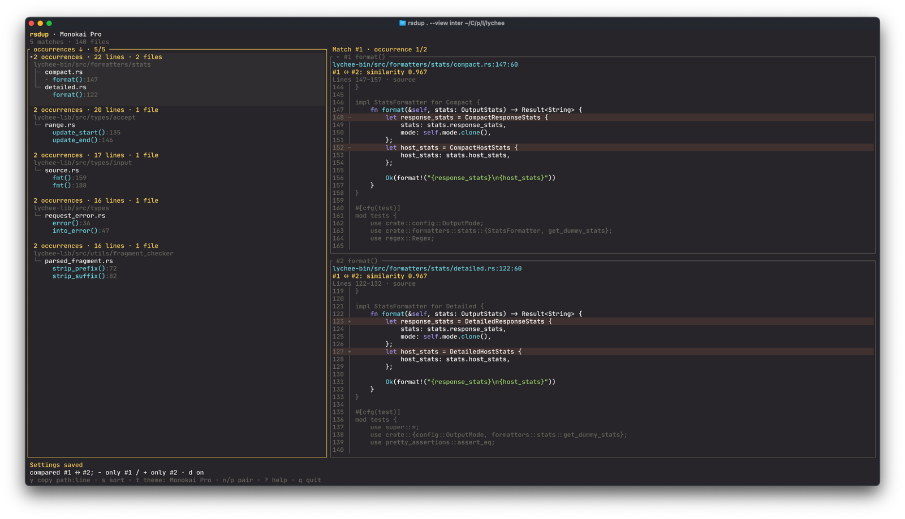

# rsdup



Find copied and similar Rust code before you fix the same bug in three places. rsdup points you to code worth comparing, lets you review the differences in your terminal, and opens matches in your editor.

Use it to look for refactoring opportunities or catch copy-paste duplication in CI. You decide whether the code belongs together: a match is not proof that two pieces of code behave the same.

## Try it

Install from a checkout with [Rust](https://rustup.rs/):

```sh
git clone https://github.com/mre/rsdup.git
cd rsdup
cargo install --path . --locked # or: make install
```

Then scan your project without downloading a model:

```sh
rsdup path/to/project --mode near-miss --view interactive
```

Want to find similar functions even when their structure differs? Leave out `--mode near-miss` to use the default semantic mode. It uses a local Ollama embedding model when one is available, or prompts you to choose a backend. `--embedding-backend fastembed` needs no server but downloads about 642 MB of model files on first use. Your source stays on your machine.

## What you get

Without `--view interactive`, rsdup prints groups and their locations. Here's an excerpt from scanning rsdup itself:

```text
1. Repeated code · 3 locations · 9 lines · 74 anchored tokens
  src/tui.rs:1699
  src/tui.rs:1728
  src/tui.rs:1790
```

The interactive browser puts matches on the left and Rust source on the right, with line numbers, surrounding context, and colored differences. A taller terminal shows two snippets at once. Browse a group, compare its occurrences, then jump into your editor.

| Key | Action |
| --- | --- |
| `j` / `k`, arrows | Move through matches or scroll source |
| `Tab` | Switch panes |
| `n` / `p` | Compare the next / previous occurrence |
| `/` | Filter by function name or path |
| `Enter` | Open the occurrence in your editor |
| `y` | Copy its `path:line` |
| `d` | Toggle differences |
| `s` / `t` | Choose sorting / theme |
| `?` / `q` | Help / quit |

Theme, sorting, and diff preferences are remembered. Theme previews are saved with Enter; Esc cancels. Use `rsdup --config-path` to locate your settings file. Set `editor = "zed --wait"` there, or pass `--editor 'zed --wait'` for one run. Otherwise, rsdup uses `VISUAL`, then `EDITOR`, then `zed`.

## Pick a mode

| Mode | Use it for | Needs a model? |
| --- | --- | --- |
| `semantic` (default) | Finding similar functions despite different calls, types, or setup code | Yes, local Ollama or FastEmbed |
| `near-miss` | Finding copied statement sequences with small expression changes | No |
| `exact` | Finding matching syntax without expression changes | No |

Syntax modes ignore formatting and comments and normalize local names and literals by default. Add `--profile strict` to preserve names and literals. Semantic scores depend on the model; not every pair in a group necessarily matches.

## Tips

- Start with a subdirectory on large projects. Semantic scans can take time; scanning less code helps.
- Tests are excluded by default. Add `--include-tests` to check them too. Directory scans honor `.gitignore`; use `--exclude 'generated/**'` for extra exclusions.
- Too many small matches? Raise `--min-lines`, for example to `10`. For fewer semantic matches, raise `--similarity-threshold` from `0.93` to `0.95`.
- Repeating semantic scans? Add `--embedding-cache target/rsdup-embeddings` to reuse embeddings. Keep caches and reports private; reports can contain source code.
- For larger syntax duplicates first, use `--mode near-miss --sort impact`. Add `--view syntax` to inspect code without opening the browser.
- The browser needs an interactive terminal, at least 60 columns by 12 rows. Rerun the scan after editing; matches don't update live.

## CI and scripts

Use a syntax mode for repeatable checks without a model:

```sh
rsdup src --mode near-miss --fail-on-duplicates
rsdup src --mode near-miss --format json > duplicates.json
```

Exit codes: `0` on success, `1` when matches are found with `--fail-on-duplicates`, `2` on error. If scripting semantic scans, choose an embedding backend explicitly rather than relying on prompts. Semantic and syntax JSON have different schemas.

Run `rsdup --help` for all options. Working on rsdup itself? `make` lists development commands; `make verify` runs formatting checks, Clippy, and tests.
